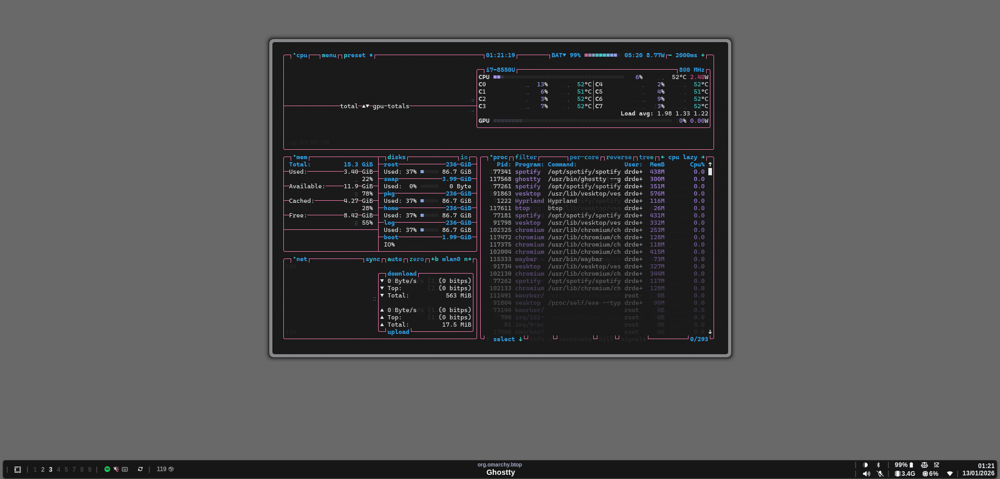

# Waybar

Bottom Waybar for Hyprland/Omarchy — module layout, a drawer of system indicators, the window-title pill, and theme-driven styling.

[Waybar](https://github.com/Alexays/Waybar) is a status bar for wlroots-based and Hyprland compositors. This config replaces Omarchy's default bar with a bottom-docked layout. It uses Hyprland and Omarchy modules and commands, so it pairs with the [Hyprland](hyprland.md) setup.

> [!NOTE]
> `~/.config/waybar` is part of the role-gated desktop layer in `.chezmoiignore.tmpl`, so it applies on `desktop` and `laptop` roles only. Waybar itself comes from Omarchy and is not in `.chezmoidata/packages.yaml`.

## Files

| Source (repo) | Target |
| --- | --- |
| `dot_config/waybar/config.jsonc` | `~/.config/waybar/config.jsonc` |
| `dot_config/waybar/style.css` | `~/.config/waybar/style.css` |
| `dot_config/waybar/window_pill.py` | `~/.config/waybar/window_pill.py` |
| `dot_config/waybar/V6.cb.png` | `~/.config/waybar/V6.cb.png` |

> [!WARNING]
> `window_pill.py` has no `executable_` prefix, and the repo file is mode `0644`. In symlink mode, chezmoi links `~/.config/waybar/window_pill.py` to that non-executable file. The module's `exec` calls the path directly, so it only runs if the executable bit is set by hand (`chmod +x` on the source) or the file is renamed to `executable_window_pill.py`.

`V6.cb.png` is a 1920×921 reference screenshot of this bar, taken with a floating btop window over a plain background. No config file references it.



## Bar settings

| Option | Value |
| --- | --- |
| `position` | `bottom` |
| `exclusive` | true (reserves space) |
| `fixed-center` | true |
| `spacing` | 2 |
| `margin-top` | 1 |
| `reload_style_on_change` | true |

## Layout

**Left**

- separator
- `custom/omarchy`
- separator
- `hyprland/workspaces`
- separator
- `tray`
- separator
- `custom/update`
- `custom/screenrecording-indicator`
- `custom/updatespacman`
- separator
- `idle_inhibitor`

**Center**

- `custom/windowpill`

**Right**

- `group/right-group2` → `group/right2` → `group/tray-expander`
- `group/right-group1` → `group/right1` → `clock`

The right side nests groups in vertical wrappers so the drawer and the two-line clock align. `group/tray-expander` is a drawer (600 ms transition, children class `tray-group-item`). It shows only `custom/expand-icon` until hovered, then reveals: `backlight`, `bluetooth`, `pulseaudio#output`, `pulseaudio#input`, `power-profiles-daemon`, `network`, `memory`, `cpu`, `battery`.

## Modules

| Module | Configuration |
| --- | --- |
| `custom/separator` (also `separator2`, `separator3`, defined but unused) | Literal `\|`, no tooltip |
| `custom/omarchy` | Omarchy logo glyph (`omarchy` font). Click: `omarchy-menu`. Right-click: `xdg-terminal-exec`. Tooltip "Omarchy Menu — Super + Alt + Space" |
| `hyprland/workspaces` | `format "{icon}"`, click to activate, pointer cursor. Persistent workspaces per output, matching the [Hyprland workspace rules](hyprland.md#workspace-rules): 1–4 on `DP-4` (Studio Display), 5–8 on `eDP-1`. Keyed by connector name, so a re-dock onto another DP port needs the key updated |
| `tray` | Icon size 12, spacing 5, shows passive items |
| `custom/update` | `omarchy-update-available` every 6 h (`interval 21600`, `signal 7`). Click runs `omarchy-update` in a floating terminal |
| `custom/screenrecording-indicator` | `$OMARCHY_PATH/default/waybar/indicators/screen-recording.sh` (JSON, `signal 8`). Click: `omarchy-capture-screenrecording` |
| `custom/updatespacman` | `waybar-module-pacman-updates --no-zero-output`, only if that binary exists. Shows an icon when updates are pending |
| `idle_inhibitor` | Activated/deactivated icons |
| `custom/windowpill` | `~/.config/waybar/window_pill.py` (JSON, `restart-interval 1`), centered |
| `clock` | `{:%H:%M\n%d/%m/%Y}` (two lines); alt `{:%H:%M - %d/%m/%Y}`. Month calendar tooltip (3 columns; month `#ffead3`, weekdays `#ffcc66`, today `#ff6699`). Right-click: `omarchy-tz-select` in a floating terminal |
| `backlight` | Device `intel_backlight`, 15-step icon ramp, tooltip shows percent |
| `bluetooth` | Off/on/connected icons, tooltip shows connection count. Click: `omarchy-launch-bluetooth` |
| `pulseaudio#output` | Icon only (headphone or 3-step speaker, muted icon). Max 100%, scroll step 2. Click: `omarchy-launch-audio`. Right-click: `pamixer -t` (mute) |
| `pulseaudio#input` | Mic / muted-mic icon. Max 100%, scroll step 1 via `pactl set-source-volume`. Click: `omarchy-launch-audio`. Right-click: `pamixer -t` |
| `power-profiles-daemon` | Icons for performance / balanced / power-saver. Tooltip shows profile and driver |
| `network` | 5-step Wi-Fi signal icons; ethernet and disconnected icons. Tooltips show ESSID, frequency, and bandwidth. Polls every 3 s. Click: `omarchy-launch-wifi` |
| `memory` | `{used:0.1f}G` every 2 s. Click: `omarchy-launch-or-focus-tui btop` |
| `cpu` | `{usage}%` every 10 s. Click: btop |
| `battery` | `{capacity}% {icon}` with 10-step charging and discharging ramps. Warning at 20%, critical at 10%, polled every 5 s. Click: `omarchy-menu power`. Right-click: `notify-send` of `omarchy-battery-status` |

Icons are Nerd Font glyphs.

## window_pill.py

A Python script that feeds `custom/windowpill` a two-line label for the focused window:

- **Top line:** the window class, small, `#a6adc8`, lowered with `rise='-2000'`.
- **Bottom line:** the title, bold, size 11000, `#ffffff`, truncated to 80 characters (`MAX_TITLE_LEN`). For Discord/Vesktop it removes the unread counter prefix such as `(209) ` and a leading `Discord | `.
- **No focused window:** shows `Workspace <id>` over a non-breaking space.

Text is HTML-escaped for Pango and printed as JSON (`class: custom-window`, tooltip `class: title`). After the first print it connects to Hyprland's event socket `/tmp/hypr/$HYPRLAND_INSTANCE_SIGNATURE/.socket2.sock` and reprints on `activewindow>>` and `workspace>>` events. It exits if `HYPRLAND_INSTANCE_SIGNATURE` is unset, which means the module does nothing outside Hyprland.

## Styling

`style.css` imports the active Omarchy theme's palette, so colors follow whatever theme Omarchy has selected (for example cyberdream):

**~/.config/waybar/style.css**

```css
@import "/home/prad/.local/state/omarchy/current/theme/waybar.css";
```

The import path is hard-coded to `/home/prad`. On another account the import fails and the `@background` / `@foreground` colors are undefined.

| Element | Style |
| --- | --- |
| All | `font-family: 'CaskaydiaCove Nerd Font Propo'`, no borders or text shadow, square corners |
| Bar box (`#waybar > box`) | `@background` fill, `@foreground` text, 2px/6px margins, 4px radius, `box-shadow 0 1px 2px` black, weight 700, size 12px, min height 30px, 0.5 s background transition |
| Window background | `@transparent` |
| Workspace buttons | Opacity 0.55. Active 1.0. Empty 0.2. Empty and active 1.0. Bold 12px |
| Modules | 6px horizontal padding, 1px margins, min width 12px |
| Separators | Opacity 0.25 |
| `custom/updatespacman` | Opacity 0.55 |
| `custom/expand-icon` | Opacity 0.5 |
| `custom/update` | 10px font |
| Tray | `@background`. Passive items dimmed, attention items highlighted |
| Tooltips | `@background`, 12px, 8px radius, `1.5px solid rgba(255,255,255,0.25)` border |
| Screen recording active | `#eb7087`, blinks to `@background` every 0.5 s |
| Battery warning | `#c95d0f` |
| Battery critical (not charging) | `#e6d8ba` on transparent, blinking to `#f53c3c` (0.5 s, 12 steps) |

## Related

- [Hyprland](hyprland.md): the compositor this bar is built for.
- [Fonts and default apps](fonts-and-apps.md): Nerd Font packages.
